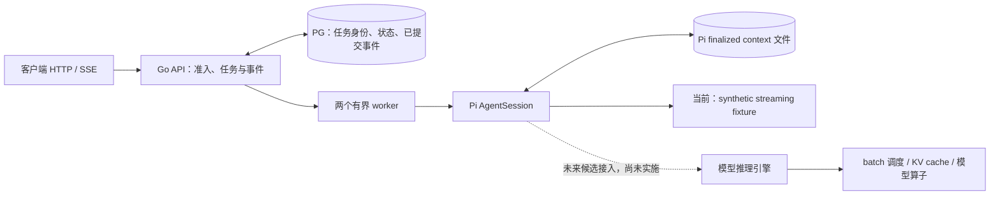

# 研究报告：从现有 Go 服务走向 AI Infra

日期：2026-10-21。Researcher Agent 为 Pi #5 Criteria 1.0 提供研究材料。本轮只读来源、分析和写文档，没有启动 server、容器、集群、GPU、模型或性能测试；没有测定 Human 掌握程度。官方具体版本与链接见[来源清单](来源清单.md)。

## 研究改变了什么决定

目前应制作三份候选：**平台可靠性 Infra、推理服务 Infra、Agent 应用开发**。这不是三个已有成熟项目方向：平台可靠性有可复查的 Pi 服务实验作为起点；Agent 开发有已批准的 Harness 原子事实和作品；推理服务方向仍主要依赖可迁移的服务机制，真实模型容量与 GPU 推理证据缺失。GPU 通信和算子暂作阅读分支，不把 DeepSeek 库加入“熟练技能”。这是依据现有材料的定位推断，不是上海实习市场已验证结论。

最关键的来源修正是版本分叉：2025 年 open-infra-index 讲 Hopper 和当时的 V3/R1；2026-10-21 的 DeepInfer、FlashMLA 和 DeepEP 主线已经不同。不能沿旧索引推断最新版兼容现有硬件。没有核对当前服务器 GPU/NPU、显存、驱动或 RDMA，因此可运行性未知，本轮不尝试安装。来源为 S01–S07。

## 共同模型：对象、状态、执行权、资源和证据

一个请求来到服务后，至少有五种不同对象：短 HTTP 请求、持续 SSE 订阅、持久任务、执行任务的 worker、模型中的 token 计算。它们具有不同寿命和限制。HTTP 连接断开，不意味着持久任务应取消；订阅很多，不意味着执行者很多；执行者很多，也不意味着 GPU 可同时承载这些上下文。

每层都问五件事：谁拥有身份？哪个状态是权威？谁有权推进状态？受什么资源限制？什么观测能证明这次推进？用这个模型可以联系线程同步、服务恢复和模型调度，但不能把不同层的机制直接等同。

实线取自 Pi accepted SHA `f1d172dda9e578cd1ff773363b14f03ff0a1d18d` 的 README 和实现；虚线为研究建议，非已实现架构。没有 GPU 模型、Redis、Kubernetes、多副本控制面或公网多用户服务的当前证据。来源 P01–P04。

## 从 Human 已学概念连接到服务机制

**goroutine 是进程内并发流程。** `go f()` 负责启动，channel、锁等机制负责协调；`context` 传播取消意图，仍需被调用方观察并退出。它不是 ROS 注册发现组件，也不等于一个独立进程或节点。若借用 ROS 经验，只能类比“一个节点进程内部存在多个并发工作流程”。这里不声称两套调度器对应。来源 S14–S15。

两个流程交替打印，目标是不允许 A 连续拿两次执行权；无缓冲 channel 的交棒表达谁先谁后。最后 B 若继续发给已退出的 A，阻塞的发送又使 WaitGroup 永远等不到结束。这同时涉及**顺序约束和生命周期**。服务里也要问“谁还会接收事件、退出后谁释放资源”，但 channel 令牌没有跨进程持久性，不能直接替代 PG 幂等键或任务所有权。

**hey 与 Vegeta 本次控制的量不同。** hey 0.1.4 本次固定并发 worker 数，完成一个请求后再发下一次，响应变慢会反馈到输入速率；Vegeta 12.12.0 本次固定目标发送速率，但需核实际发送与完成速率、max-workers 及发生器资源。hey 的 `-q` 是每 worker 限速；Vegeta 有并发上限，二者并非互斥工具类别。来源 S16–S17、P02。

因此，hey 的 `-c=100`、Vegeta 的 `500 requests/s`、SSE 的 `10,000` 订阅、API 的 goroutine 数和两个任务 worker 不能并列当作同一个“并发能力”。分析时先画进入、排队、开始、完成、退出，再分别看实际速率、在途数、延迟和失败。当前 HTTP 请求是 health 或两行小 history 读取，不是一次模型生成。

## DeepSeek 各层到底解决什么

### 推理引擎与服务控制面

Prefill 把输入上下文转换成模型中间状态；Decode 逐步生成后续 token。把二者分离能采用不同资源配置，但也引入 KV 状态传递、负载均衡和生命周期协调。2025 V3/R1 官方系统概览给出了分离与通信计算重叠的实例；这是特定历史系统，不是本项目已实现能力。来源 S02。

当前 DeepInfer README 将公开范围限定为离线推理。它列出模型/采样运行时、并行及异步 batch 调度等核心功能，同时明确完整服务仍需 KV cache 系统、VE/Prefill/Decode 分离和 Prefill/Decode 数据并行副本的负载均衡。支持硬件为 NVIDIA SM100 或 Huawei Ascend 950；Linux、GCC≥13、Python 3.12，分别需要 CUDA 13 或 CANN 9.2。README 的基准硬件是 Prefill 4 个 SM100、Decode 64 个 SM100，不能当最小运行卡数或我们的性能。来源 S03。

**推断：** Pi 现有 Go 层接近服务任务控制面：接纳、保存、排队、呈现结果；它的两个 worker 不是 GPU batch scheduler。未来接入引擎时还需模型版本/输入输出契约、token 生命周期、取消和不确定执行处理。读取 DeepInfer 不能自动给现有系统补上这些实现。

### 三种“缓存”不是一种状态

PG 事件用于证明服务已提交什么，Pi finalized context 用于恢复上游会话上下文；SSE tail 仅是可丢弃的事件读取优化。模型 KV cache 保存注意力计算所用的键值中间表示，以避免重复计算。恢复 SSE 游标不等于恢复 KV tensor；PG 事务也不意味着 GPU 或 Pi 文件与它共同提交。来源 P01、S02–S04。

3FS 的作用是共享文件存储，利用 SSD 和 RDMA；设计区分 cluster manager、metadata、storage 和 client。元数据依赖事务 KV 存储，chunk 复制采用 CRAQ；链版本和成员变化是其恢复设计的一部分。可学习“谁决定成员、写入何时可见、恢复如何影响负载”，而非把“用了 PG”直接等同分布式文件系统。官方部署还涉及 RDMA、多盘、FoundationDB 等条件，不能把 Docker 构建镜像当作完整低成本复现。来源 S04。

### 通信与算子：沿实际瓶颈阅读

DeepEP 关注 MoE token 在 experts 之间 dispatch/combine 的通信。当前固定版采用 NCCL Gin 和 DeepJIT，要求 Hopper 或更新 GPU、CUDA≥13.1、PyTorch≥2.10、NCCL≥2.32.3；节点内依赖 NVLink，跨节点依赖 RDMA。旧 NVSHMEM 版本教程不代表当前版。IB 已测试与 RoCE 理论兼容的来源强度也不同。来源 S05。

DeepGEMM 当前版提供 GEMM 等 tensor-core 计算原语；SM90/SM100、CUDA≥12.9、PyTorch≥2.3、C++20 等为 README 基本要求，具体功能还有更严格前提，例如 Mega MoE 的对称内存和多进程，不能仅凭基本要求判断所有功能可跑。来源 S06。

FlashMLA 当前版面向 attention kernels，2026-09-30 的 breaking change 移除了 Hopper 和 V3/V3.2/V4.0 支持，并改变 KV 格式；NVIDIA 路径要求 SM100/SM103、CUDA≥13.1、PyTorch≥2.10，另有 Ascend 950/CANN≥9.2/torch_npu 路径。需要老硬件/模型时应另锁官方指定历史 commit，并重新核其条件。来源 S07。

**推断：** goroutine 能组织控制面 I/O，并不会实现 GPU kernel 的并行计算或跨卡通信；同时启动更多 Go 任务，可能只扩大队列与显存压力。在真实模型、token 长度、batch、显存和设备利用率证据缺失时，优化通信库不是现阶段最小投入。

## 分布式与容器：现有项目的边界在哪里

**项目 Evidence：** Pi 通过 PG session advisory lock 限制单控制实例；两个进程内 worker 领取任务，同会话串行，不同会话可并发。数据库中的身份、终态和事件与 Pi 文件/外部调用不共享事务。重启时原 running 标 interrupted，阻断该会话后续任务；不自动重发模型请求。请求幂等不等于外部执行 exactly-once。来源 P01、P03，官方锁机制参考 S12–S13。

**来源事实：** PG 的行锁/事务 advisory lock 在事务层协调数据访问；session advisory lock 的寿命不同。`SKIP LOCKED` 可跳过已锁行，但读到的不是通常意义的一致视图，官方提到其队列用途。是否能扩展为多控制实例，还要重新定义任务执行权、租约/旧执行者、Pi 上下文和失败恢复；目前没有多机一致性或 HA 证据。来源 S12–S13。后一句为项目缺口判断。

**来源事实：** Docker namespaces 隔离可见资源，cgroups 管理资源使用；volume 的寿命可跨容器，但不会自行产生跨主机副本、备份或一致性。容器共享宿主内核，daemon、挂载、capabilities 等会改变攻击面，不能当完整安全沙盒。来源 S08–S09。

**项目 Evidence：** Compose 把 PG、API、Pi/fixture、负载端置于合计 4 CPU/8 GiB 硬配额，来源/Node 只读挂载，数据卷单列，端口只绑 loopback；这支持受控容器实验的描述。它没有证明权限加固覆盖、不可信代码隔离、多租户或生产运维。来源 P01–P02、P04。

**来源事实：** Kubernetes controller 观测实际状态并尝试靠近目标状态；scheduler 为待调度 Pod 选择节点；kubelet 管理已分配节点上的容器。requests 参与调度，limits 约束运行资源，CPU 节流与内存 OOM 的行为不同。Pod 可被替换，替换后 UID 改变；进程重启并不自动恢复业务事务或任务幂等。来源 S10–S11、S18。

**推断：** K8s 可练资源与恢复，但将 Compose 换成 YAML 并不能让 Pi 单实例成为多副本服务。当前优先解释原有数据/恢复边界，再以独立教学实验研究 Pod 重建；先不建设完整 AI 集群。

## 已验收数值可以支持什么

Pi #1/#3 已由独立 Regulator accepted 并合入，P05–P06 为 Verdict 定位；这里仍引用原报告，不声称本轮重新复算或新复跑。

- 54 轮 hey/Vegeta 共 72,600 次观测请求均 HTTP 200，属于短 health/history 请求矩阵。固定并发与固定速率分别报告，不推断真实模型吞吐。
- #3 SSE 一次 120 秒 hold 的 24 次服务采样均为 10,000 在线订阅；有 1,000 次计划重连和 21 次服务写失败，原因未定，不是 10,000 TCP 全程不中断。
- 仍是 synthetic 模型端点、单控制实例、最多两个任务执行者。同机负载发生器和共享宿主影响测量；历史很小，任务 polling 延迟不是 TTFT/TPOT。
- 缓存开关控制 SSE event tail，而 health/history 请求没有因此测试到该缓存收益；不声称缓存加速 history。C10K 不证明多机、多副本、生产容量或个人独立完成。

## 三份简历的表达决定与剩余未知

平台可靠性稿展开任务持久化、幂等、恢复取舍、容器资源和负载口径；推理服务稿展开到达/完成速率、排队、流式交付及推理引擎的边界；Agent 开发稿展开已有批准协议、执行、Trace 与评测事实。事实保持同一份，改变的是解释的工作问题，不创造新的成果。

Pi 新事实尚未获得现实简历披露批准；Human 提出目标与约束，Agent 实现和执行的部分、上游 Pi/Go/PG/工具能力必须单列归属。DeepSeek/K8s 阅读不能写为实现经验或熟练技能。当前没有完成上海实习 JD 有效性核验，现有腾讯社招仅是历史方向参照；本轮不扩大招聘搜索，不据此宣称市场统一要求。

下一步及停止条件见[学习与实验建议](学习与实验建议.md)。候选稿是否满足合同由独立 Regulator 核查，最终披露由 Human 决定。
