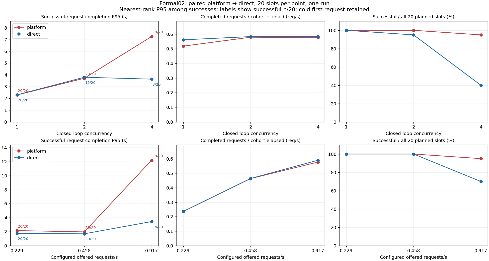

# Pi13 formal02: actual paired load baseline, 2026-11-10

Status: **Builder measurement complete; independent measurement review has no blocker; final exact-SHA acceptance remains pending.** This directory is Evidence only. It records the complete new run, not a continuation or repair of the earlier partial formal01. No C10K inference, performance improvement, hardware capacity limit or resume disclosure is established.

## Result and denominator

All 12 frozen points ran once, 20 planned and 20 sent per point: **240 sent = 219 complete + 19 direct rejected + 2 platform failed**. There were zero generator drops, timeouts or unresolved slots. Native model trace has 240 received and 219 executed/settled. All successful outputs contain 63 native output tokens (13,797 total); actual prompt tokens vary 75/76/77, and each paired request preserves the same full input.

[Curves CSV](curves.csv) and [original point results](results.json) retain configured arrivals, complete-in-offer throughput and cohort/drain throughput separately. The figure below shows success-conditioned P95, actual cohort throughput and success fraction side by side. P95 is nearest-rank over the successful n; n=0 would remain null. A lower P95 with fewer successful requests is not a service improvement.

| Point | Complete /20 | Rejected | Failed | Success P95 s | TTFT P95 s | Complete req/s | Output tok/s |
|---|---:|---:|---:|---:|---:|---:|---:|
| platform_closed_1 | 20 | 0 | 0 | 2.289 | 0.198 | 0.518 | 32.632 |
| direct_closed_1 | 20 | 0 | 0 | 2.302 | 0.050 | 0.561 | 35.348 |
| platform_closed_2 | 20 | 0 | 0 | 3.708 | 1.957 | 0.579 | 36.474 |
| direct_closed_2 | 19 | 1 | 0 | 3.795 | 1.898 | 0.583 | 36.747 |
| platform_closed_4 | 19 | 0 | 1 | 7.257 | 5.603 | 0.576 | 36.286 |
| direct_closed_4 | 8 | 12 | 0 | 3.635 | 1.987 | 0.584 | 36.774 |
| platform_open_0.5 | 20 | 0 | 0 | 2.148 | 0.141 | 0.236 | 14.880 |
| direct_open_0.5 | 20 | 0 | 0 | 1.749 | 0.042 | 0.236 | 14.899 |
| platform_open_1 | 20 | 0 | 0 | 1.960 | 0.173 | 0.463 | 29.178 |
| direct_open_1 | 20 | 0 | 0 | 1.687 | 0.045 | 0.464 | 29.224 |
| platform_open_2 | 19 | 0 | 1 | 12.195 | 10.566 | 0.577 | 36.361 |
| direct_open_2 | 14 | 6 | 0 | 3.438 | 1.829 | 0.590 | 37.161 |

There are no independent repeats. Platform always precedes its paired direct cohort, cold first requests remain included, and point ordering is fixed. Each point is exploratory n=20. Direct C4 completes only 8/20, so its 3.635s success P95 cannot be compared as a general latency win against platform C4's 19/20 at 7.257s. Offered rates are approximately 0.229, 0.458 and 0.917 requests/s. A finite cohort can finish before the nominal 20/rate offer window (last send at 19/rate), so cohort req/s can exceed configured rate without an extra request; use complete-in-offer for the separate window statistic.

## What the traces establish

The native 219 execute intervals do not overlap: observed maximum active generation is one, matching the model service's existing single asyncio lock. Pi sampled active workers reach two; model queue samples reach three. At platform C4, PostgreSQL queued→running P95 is 3.733s; at 2Rb it is 8.355s. These are durable event intervals on the database clock, not pure API CPU time. Go spans use since-claim nanoseconds; native model spans use its own monotonic clock. No cross-process clock subtraction or subtraction of unrelated quantiles is used.

All 19 direct failures retain original HTTP503 error bodies with `queue_deadline`, consistent with the unchanged model queue deadline of two seconds. Two platform requests were ACKed202 and ended durably interrupted with bridge `upstream_http_503`: C4 task178d85edd0b3f1bf9a9059a5752c6d8c and 2Rb task6fcf5d16f670da710a4c2513d1d7a15a. Their bridge-local model call spans are about 2.004/2.005s. The bridge does not preserve the upstream error body, so the literal code for these two is **unknown**; queue_deadline is an inference, not a recovered raw error code. Failed usage remains unknown/null, not zero output tokens.

GPU0 has 545 diagnostic samples, observed VRAM peak16,288MiB and sampled utilization peak81%. These values do not establish VRAM capacity, bandwidth, SM occupancy or hardware throughput as the limiting cause. Serialization is directly observed; whether continuous batching, KV-cache policy or chunked prefill improves the same workload remains future work. Existing use_cache is within one autoregressive generation, not a continuous-batching implementation.

The separate pilot05 profiler contains actual CUDA execution: 1,070,255 Chrome trace events and 135,424 CUDA kernel events on device0. Its summary and parser are included; the 309MB original stays outside Git with full hash and two locations. It profiles the first pilot platform request, source45faa, with cold/profiler-export overhead before terminal completion. It is not part of formal latency and kernel count/duration sums are not a bottleneck proof or exclusive wall-time percentage.

## Execution identity and calibration

- Execution source: **260831db022021289e5e29776292385f81cd8078**, after SC06 CPU status/summary repair. Final delivery adds only Evidence and navigation. Model/SDK/load/pairing bytes are unchanged from the independently checked pilot05 and R4 source45faa56c5656314bee56825bd9418e21ae1466ef; their actual execution SHA is not relabeled.
- Reused Go API executable SHA256 **9042a98be49b12a6a18274f96927864d792ef88dee0d752e5b5fc6f069dac87e**, actual build revision394e4f15a821ab969a104aae7f8803d3efd3ef72. [Go source byte map](api-binary-source-map.json) records identity; it was not rebuilt from260831. [Other execution bindings](execution-bindings.json) pin the actual runtime files.
- Calibration: actual platform3→frozen full input vector→direct3, all six complete. Rb=2/(2.1859577849972993+2.1770220730104484)=**0.45840229959559176** successful direct requests/s, using the last two direct durations; no warmup, retry or substituted pair. Vector full SHA f06e3e2550c95dd2d3c4957c6b294e033698d202f0709a275104652955c23c5f. SDK session workspace context is preserved, not normalized away.
- Frozen formal plan **854136c61737c37b4aedb14423230694f314a48e81bb40b1f5ddfe104294a329**, trace **e49bf8cb1cfd37d92c8f864164c06917c5080d5f85e4048b396ead495ea76770**. All 240 new client/session/key IDs are disjoint from the known historical253; server task UUIDs are observed in PG. Each cohort runs platform→capture/freeze actual full-field vector→direct exact replay; each missing pair would retain its planned slot.
- New once-only phase5 nonce pi13-nov10-phase5-formal02-once. Literal GO **9872e7d02c916d1d1cf7bc47c08abf8f7bdda368f48801a3a7068ce8217e0c66** frozen13:49:20.565024Z, deadline14:04:20Z. Original phase4 nonce was unused and retired. No deadline extension or third full run occurred.
- Model hardware: GPU0 RTX4090, UUID GPU-3c2dd9d8-e925-9c8e-373e-efc7b1222ead, CUDA_VISIBLE_DEVICES=0. Exact project/UID/resource and double fresh idle samples precede model start. Profile0/warmup0/retry0; no business admission or concurrency policy changed for the experiment.
- Native launch13:49:23.790656–13:58:31.541191Z, watch ended13:58:31.910415Z; native/watch/entry exits0 with complete12 summaries and no stopped reason. Outer entry checks fresh native/watch outcomes rather than trusting the old coordinator's own return code. Entry/coordinator under frozen-execution-reference are immutable execution references, not default Product entry points.

## Cleanup, cost and failed attempts

Model lifetime13:49:36.594788837–13:58:30.241833744Z is exactly533.647044907s (ledger rounded533.647045). The owned model was stopped with exit137 and OOMKilled=false; this is not claimed as natural graceful completion. Final exact-owned stop/remove and independent watch termination are retained, followed by an actual successful empty owned inventory command. Final GPU snapshot has no compute PID,6MiB/util0. B+R experiment disk795,722,907+89,769,008 bytes, free2,630,080,655,360 bytes. Unknown discovery would not count as owned0.

Cumulative Builder cost includes failed preparations, pilot and prior partial: **886.871656s /303 model HTTP calls**, within1500s/320. Independent R used25.564429079s/four model calls, kept separately. This formal run contributes533.647045s/240 calls. CI6 is the actual successful execution-source run42822018807 (26 required load/monitor/pair tests, skip0); no unchanged CPU suite was rerun merely for this Evidence commit. Conditional CI7 and final exact-SHA Verdict remain separate.

Earlier formal01 remains **240 planned /60 sent /50 complete /10 failed /180 not run**, and is never spliced into these results. Its post-point idle connection refusal overwrote an already measured point, while cleanup/native return codes misleadingly appeared successful. SC06 retains existing point summaries, writes explicit stopped status and propagates failure outward. Independent actual CPU red→green and immutable recovery evidence reside in [the repair record](../20261110-interrupt-repair/README.md). Foreign PID ownership in that earlier incident remains unknown; it is not recast as OOM, hardware saturation or business panic. The phase4 missed-start reserve and outer-coordinator return-code gap are also retained in the case below.

## Evidence inventory and offline use

- [formal02-originals.tar.gz](formal02-originals.tar.gz): unchanged original7,083,876-byte archive, SHA ecec03f76ff4ce14f8c956dcfad6aef782409ef17a2b33bdb66a640863ead01e. It holds all1388 manifest-pinned files plus the embedded manifest: full per-slot HTTP/SSE wire, ledgers, paired payloads and freezes, native model trace, PG tasks/events, ready/config/inspect/logs, idle checks, watch control/diagnostic command receipts, exact cleanup and final inventory.
- [raw-manifest.json](raw-manifest.json): SHA28d14f9044e5bf469652e919055787daa330a9ec52ba5a3fadfdf57c6b2aec0d. [verify_archives.py](verify_archives.py) independently hashes archive members without executing or extracting them. Run `python verify_archives.py`; both original/subset member sets must match exactly. Archive also retains its original manifest separately from the1388 measured files.
- [Calibration subset archive](calibration-originals-excluding-profile.tar.gz) and [subset manifest](calibration-committed-manifest.json):145 byte-identical originals. [Original146-file manifest](calibration-original-manifest.json) includes the external full profiler. This is an explicit subset, not a claim all146 files are in Git.
- [external-artifacts.json](external-artifacts.json): large profiler and earlier partial archive locations/hashes; originals preserved. Private raw contains local paths and the already tracked isolated experiment database configuration, not publication-ready material.
- [control-receipts](control-receipts/README.md): foreground clock/preflight/readback/native/watch/outward outcome. [Frozen execution references](frozen-execution-reference/README.md): entry/coordinator and prospective Master GO, no executable default change.
- [accounting.json](accounting.json), [diagnostics.json](diagnostics.json), [failed/rejected client slots](nonsuccess-ledgers.json), [platform failed call correlations](nonsuccess-bridge.json): derived views with original identity links; originals remain authoritative.
- [render_curves.py](render_curves.py), [plot provenance](plot-provenance.json), [SVG](curves-with-denominators.svg), PNG, curves.csv, results.json and [table](results-table.md): offline presentation only. Original CSV CRLF bytes are preserved, so Git whitespace checking explicitly excludes only that original CSV. Generated SVG whitespace is normalized. Plot used existing experiment Python/Matplotlib3.10.6; default Python had a NumPy ABI mismatch and was not repaired or installed over.
- [Profile summary](profile05-summary.json) and [parser](summarize_profile05.py): derivative only, full source profile hash above.
- [Learning and private X draft](CASE-AND-X-DRAFT.md): one concrete failure and correction, not public posting or a new fact ledger.
- [package-manifest.json](package-manifest.json) hashes delivered files except itself. The final candidate SHA is bound in external Handoff after commit; this document intentionally does not chase its own SHA.

Independent measurement receipt is referenced, not imported as a Builder probe: FORMAL02-MEASUREMENT-REVIEW.json, SHA e5d3b4cdd9f8a96d00702383aec0bb7cdc68b52d68f505ec903342a7b82fbffc. It confirms reproducibility, not final accepted. Master supplies direction/budget and exact GOs; Builder implemented and ran the candidate; R independently reviewed and executed its own double-chain checks. Human did not personally implement these Agent changes. Product facts and real-resume disclosure require their separate governance and Human authorization.
